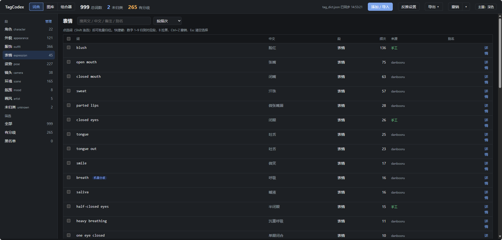
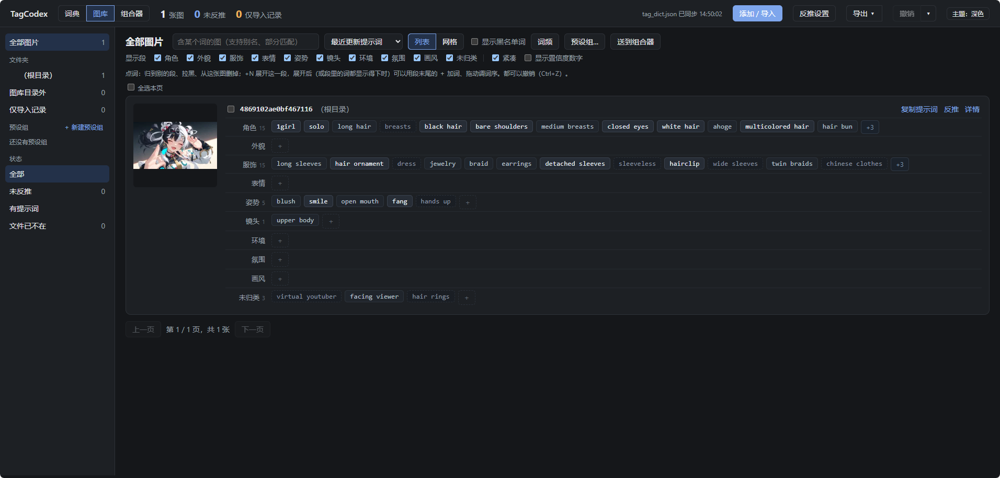

# TagCodex

**本地的 Danbooru 标签词典 + 图库 + 提示词组合器**，给用 ComfyUI / Stable Diffusion 出二次元图的人整理提示词用。

把反推出来的一堆标签按你自己定的「段」（角色、外貌、服饰、表情、姿势、镜头、环境、氛围、画风……）归好类，攒成一本越用越准的词典；图库里每张图的提示词都按段显示、能直接改；组合器按段批量换掉角色、服饰、画风，导出 txt / xlsx 拿去批量出图。

> English: TagCodex is a local tool for organizing Danbooru-style prompt tags. It classifies tags into user-defined segments (character, outfit, pose, camera, …), keeps a gallery of reference images with editable per-segment prompts, includes a built-in WD14 tagger (CPU, ONNX), and a composer that batch-replaces segments and exports prompt files. Windows only; the UI is Chinese only for now.

> [!WARNING]
> **本项目的代码全部由 AI 编写，还没有经过人工完整审查。** 作者日常在用，有自动化测试，但可能仍有没发现的问题。使用前请备份你的图片和 `data/` 目录（图片只读不改，数据库升级前会自动备份），遇到问题欢迎提 issue。
>
> All code in this project was written by AI and has not yet been fully reviewed by a human. Back up your data before use.





## 功能

- **标签词典**：从 danbooru 参考表、反推结果（xlsx / txt）、手工粘贴导入；按段批量归类（数字键 1–9）、拉黑、合并同义词、段的增删改排序；机器意见有分歧时进队列让你定；所有改动都能撤销
- **图库**：扫描本地图片目录（文件夹怎么分都行，左栏按文件夹显示），缩略图浏览、筛选、按段看和改每张图的提示词，复制提示词，关联生成图和原图，词频统计
- **内置反推**：WD14 tagger（默认 `wd-eva02-large-tagger-v3`），本机 CPU 跑，不需要开 ComfyUI；预处理与 [comfyui-wd14-tagger](https://github.com/pythongosssss/ComfyUI-WD14-Tagger) 逐词一致
- **组合器**：预设组（一个角色 / 一套衣服的多段提示词 + LoRA）、按段的槽（保留 / 替换 / 前加 / 后加 / 删词 / 清空）、实时预览，导出 txt 目录 / xlsx；也可以从零建一套空白提示词
- **tag_dict.json**：词典改动后自动导出的快照，外部程序（比如你自己的 ComfyUI 节点）可以读它按同样的段给标签分段，格式见 [docs/标签词典-使用说明.md](docs/标签词典-使用说明.md#tag_dictjson)

## 安装

需要 Windows 和 [Python 3.10 以上](https://www.python.org/downloads/)（安装时勾选 Add python.exe to PATH）。

1. 下载本仓库（Code → Download ZIP 解压，或 `git clone`）
2. 双击 `install.bat`。它会：
   - 建 `.venv`，装依赖（flask / pillow / openpyxl）
   - 生成 `config.json`
   - 下载 danbooru 参考表（约 9MB）
   - 问你要不要启用内置反推。选是会装 onnxruntime，并从 HuggingFace 下载模型（约 1.3GB）。以后想用再运行一次 `install.bat` 也行
3. 双击 `run.bat`，浏览器打开 http://127.0.0.1:5077/
4. 第一次进去先在顶栏「反推设置」→「danbooru 参考表」里导入 danbooru 表

`install.bat` 可以重复运行，做过的步骤会跳过；模型下到一半断了，再运行会接着下。

模型先从 huggingface.co 下，连不上会自动换国内镜像 hf-mirror.com。想直接指定镜像，或者 pip 装依赖太慢，在命令行里先设好再运行：

```bat
set HF_ENDPOINT=https://hf-mirror.com
set PIP_INDEX_URL=https://pypi.tuna.tsinghua.edu.cn/simple
install.bat
```

界面用的 Vue 从 CDN 加载，需要联网，首次打开可能白屏几秒。

## 配置

`config.json`（第一次运行时从 `config.example.json` 生成）。相对路径都相对项目目录；没填的路径只会让对应功能不可用，其他照常。

| 键 | 说明 |
| --- | --- |
| `gallery_root` | 图库根目录，用图库功能要自己填（也可以在扫描页填） |
| `composer_output_dir` | 组合器默认输出目录，留空则导出时再填 |
| `danbooru_xlsx` | danbooru 参考表，默认 `data/danbooru_tags.xlsx` |
| `tagger.models_dir` | 反推模型目录，默认 `data/models`；已经装了 comfyui-wd14-tagger 的，可以直接指向它的 `models` 目录 |
| `db_path` | 词库，默认 `data/tagcodex.db`。备份就复制这一个文件 |

完整说明见使用说明。

## 使用说明

- [标签词典](docs/标签词典-使用说明.md)
- [图库](docs/图库-使用说明.md)
- [组合器](docs/组合器-使用说明.md)

## 注意

- **只监听 127.0.0.1，不要改成 0.0.0.0 对外开放。** 有些接口会按你给的路径读取本机文件（导入 xlsx、扫描目录），它是给自己一个人在本机用的，没有任何登录或权限控制
- 图片只读：扫描和反推不会移动、改名、删除你的图片，只写自己的数据库和缩略图目录
- 目前只在 Windows 上用过；界面只有中文；反推只用 CPU

## 第三方

模型和 danbooru 表不随仓库分发，由 `install.bat` 从原始出处下载，许可证见 [THIRD_PARTY.md](THIRD_PARTY.md)。

## 许可证

[MIT](LICENSE)
